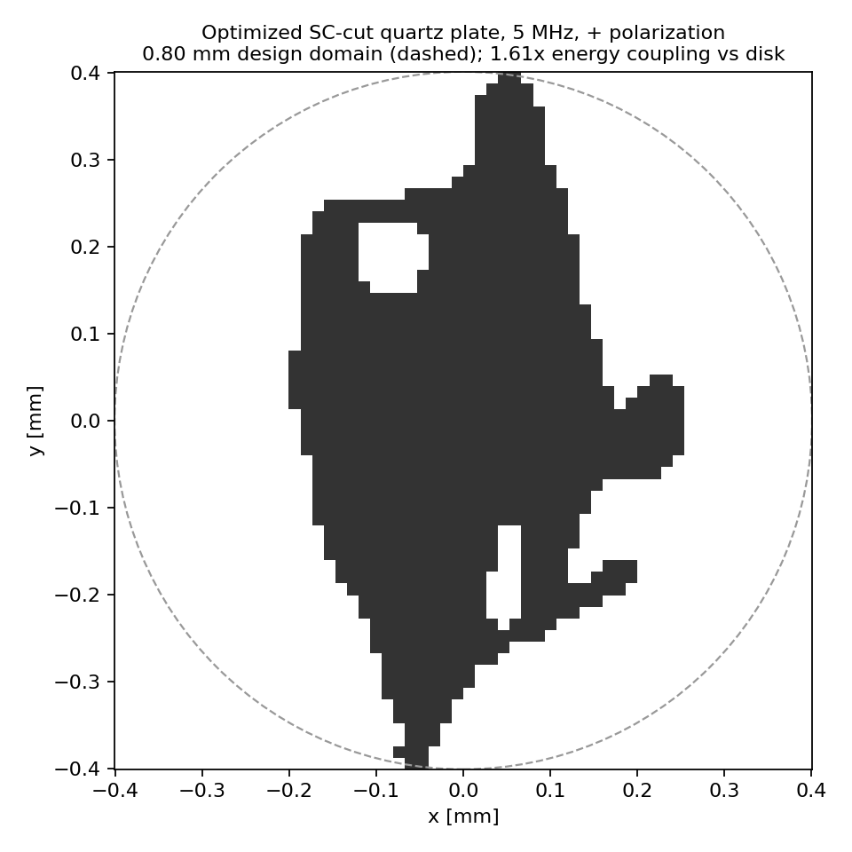

# Shooting higher: a DIY gravitational-wave antenna

## TL;DR

I used topology optimization to reshape a 5 MHz quartz plate so it picks up more energy from a passing gravitational wave. The optimized shape is a compact, bar-like body. It captures 92% of the wave's tidal pattern, versus 66% for a plain disk, and takes about 1.6× more energy per unit volume. Optimizing the plate for raw coupling η instead gives designs that game the metric. Geometry alone can't make this a working detector.

**Try it:** [Topology explorer](https://claude.ai/artifact/9CsM5Kr8bC3CCRqEoYJ8ws) · [Arcade game (Ringdown)](https://claude.ai/artifact/4i5DJDKYc74CYgihveRmmA)



## Why I'm doing this

It's hard to tell when you're on an exponential curve. Over the span of one project, something that doubles every year looks like a straight line. Two years ago AI could barely make sense of a forecaster's free-form National Weather Service discussion, and now ActuallyWeather can use Haiku to read them and generate labels for the weather pattern behind each forecast. If I believe AI capability is compounding, the right move is to aim higher than feels reasonable. So I picked the hardest project I could imagine: building a gravitational-wave telescope myself.

## AI is already redesigning the big detectors

The Urania system from Krenn, Drori and Adhikari produced 50 interferometer designs that all beat the LIGO Voyager baseline, which means new topologies rather than just better parameter settings. See the [GWDetectorZoo](https://github.com/artificial-scientist-lab/GWDetectorZoo). This repo works on a different part of the telescope: the antenna.

## Antennas are an inverse-design problem

Material-distribution topology optimization began as a method for load-bearing elastic structures and was later extended to acoustics, optics and metallic antennas. Hassan, Wadbro and Berggren published the [metallic-antenna version](https://people.cs.umu.se/martinb/downloads/Papers/HaWaBe14a.pdf) in IEEE Transactions on Antennas and Propagation in 2014. Recent work, such as Neuman, Capek and Jelinek (2025), focuses on keeping optimized shapes regular enough to manufacture. I tried the same approach on a quartz plate whose "radio wave" is a gravitational wave.

## What I built

- 2D plane-stress FEM of a free-free SC-cut quartz plate, scaled so its best-coupled mode sits at 5 MHz, with volume matched to a reference disk.
- Tidal body force from a passing wave, with coupling η and a pattern-capture fraction χ as the metrics.
- SIMP topology optimization (p = 3, density filter, minimum feature size) across objectives, polarizations and volume fractions.
- Result: the optimized plate reaches χ ≈ 0.92 versus 0.66 for a plain disk.
- Explore it: [Quartz Plate Topology Atlas](https://claude.ai/artifact/9CsM5Kr8bC3CCRqEoYJ8ws) and the arcade game [Ringdown](https://claude.ai/artifact/4i5DJDKYc74CYgihveRmmA).

## What this does not show

- Geometry can only capture the tidal pattern, and χ tops out at 1. At best this is a factor of about 1.5 over a disk, not orders of magnitude.
- Quality factor, thermal noise and readout dominate real sensitivity, and none of them are modeled here.
- Thickness-shear modes and piezoelectricity are left out.
- With the solver's default assumptions, signal-to-noise for even a nearby inspiral is about 10⁻¹⁸. This is a study of the antenna's geometry, not a detector.

## What's in this repo

| path | what it is |
|---|---|
| [run_poc.py](run_poc.py) | Runs one optimization and writes a `results_<objective>/` folder. Details below. |
| [quartz.py](quartz.py), [fem.py](fem.py), [coupling.py](coupling.py), [topopt.py](topopt.py), [waveforms.py](waveforms.py) | Material, FEM, coupling metrics, SIMP/MMA optimizer, GW waveform models. |
| [sweep.py](sweep.py) | Runs every objective × polarization × volume fraction (0.2–0.6) into `results_sweep/`. |
| [build_viewer.py](build_viewer.py), [viewer.html](viewer.html) | Bundles the sweep into one self-contained page. Open `viewer.html` in a browser. |
| `results_energy/`, `results_eta/`, `results_*_quick/`, `results_sweep/` | Saved outputs: summaries, plots, density fields and logs. |
| [game/ringdown.html](game/ringdown.html) | Ringdown, the arcade game. One file, no build step: open it in a browser. |
| [game/calibrate_proxy.py](game/calibrate_proxy.py) | Checks that the game's fast scoring ranks the optimized and disk designs the same way the real solver does. |

### Ringdown

Waves arrive faster and faster. Before each one hits, turn (◀ ▶) and tune (▲ ▼) a four-armed quartz crystal until it matches the wave's polarization and frequency, then press Space to ring it. The scoring is an arcade approximation of the coupling, not the FEM: mass far out along the wave's axes catches more, and spreading the crystal out lowers its pitch. `calibrate_proxy.py` confirms the approximation ranks the plain disk and the two optimized plates in the same order as the real solver.

---

## Technical details: GW-antenna topology-optimization proof of concept

**Hypothesis.** A topology-optimized SC-cut quartz plate has higher gravitational-wave (GW) modal coupling than a plain disk of equal volume at the same target frequency (5 MHz).

This is a deliberately minimal, single-hypothesis test: a 2D plane-stress FEM, SIMP topology optimization, and literature-based MHz GW waveforms. It is a numerical experiment, not a detector design.

### How to run

```bash
python3 -m venv .venv
.venv/bin/pip install -r requirements.txt          # numpy, scipy, matplotlib

.venv/bin/python run_poc.py --selftest              # physics and gradient sanity checks (~10 s)
.venv/bin/python run_poc.py --check-grad            # adjoint vs finite differences, both objectives
.venv/bin/python run_poc.py --quick                 # 40x40 smoke test (~15 s, not converged)
.venv/bin/python run_poc.py --objective eta         # full run, the brief's metric (~5-10 min)
.venv/bin/python run_poc.py --objective energy      # full run, energy-per-volume metric
```

Useful flags:

| flag | meaning |
|---|---|
| `--pol {+,x}` | polarization to optimize for |
| `--mode {best,auto,<k>}` | mode selection (see the "Mode selection" assumption below) |
| `--n` | mesh size |
| `--rmin` | filter radius in elements; default n/20 |
| `--volfrac` | volume fraction; default 0.4 |
| `--start {disk,uniform}` | initial design |
| `--Qm` | mechanical Q |
| `--T` | temperature |
| `--burst-h0` | burst amplitude |
| `--waveform-file` | any `t,h+,hx` CSV, e.g. a mass-rescaled NR waveform |

Outputs go to `results_<objective>/`:
- `summary.md` / `summary.json`: the comparison table, verdicts, and waveform energies.
- `geometry_and_modes.png`: optimized density, the disk mode, and the optimized mode, at physical 5 MHz scale.
- `convergence.png`: optimization history.
- `waveform_response.png`: strain and modal displacement versus time for each literature waveform.
- `density.npy`: the final density field.

### What is computed

1. **Material.** α-quartz Bechmann constants are rotated to the SC-cut, IEEE-176 (YXwl) φ = 22.4°, θ = 33.88°, using the 6×6 Bond matrix ([quartz.py](quartz.py)). The exact anisotropic plane-stress matrix is the inverse of the in-plane block of the compliance S = C⁻¹. ρ = 2650 kg/m³.
2. **FEM.** Structured bilinear Q4 elements on a square ([fem.py](fem.py)). The design domain is the inscribed disk, and the plate is free-free. Shift-invert `eigsh` solves the generalized eigenproblem.
3. **GW tidal load** (long-wavelength limit, proper detector frame): f_i = ½ ρ ḧ_ij x_j, with e₊ = diag(1, −1) and e× = offdiag(1, 1). The wave propagates along the plate normal.
4. **Coupling metric, as defined in the brief:** η_n = |∫φ_n·f dV| / (M_n ω_n² h) = ½ |Q_n : e| / M_n, where Q_n^ij = ∫ρ φ_i x_j dV and M_n = ∫ρ|φ_n|² dV. φ_n is normalized to max|φ_n| = 1 over **solid** material, so η has units of length.
5. **Normalization-free companions** (see "Important finding" below):
   - χ = (Q:e)² / (M_n ∫ρ|e x|²) ∈ [0, 1]: the fraction of the tidal pattern that the mode captures.
   - Γ = (Q:e)² / M_n: the deposited energy for any waveform is proportional to Γ. The table reports Γ/V.
6. **Scaling to 5 MHz at equal volume.**
   - Every design is solved on a W₀ = 1 m reference domain and then scaled laterally by s = f₀/5 MHz. This scaling is exact: f ∝ 1/L.
   - In plane stress the in-plane frequencies don't depend on thickness. So the thickness is set to make all volumes equal to that of the disk (t/D = 0.1).
   - Consequence: maximizing η at a fixed 5 MHz is the same as maximizing the scale-invariant η·ω on the reference domain, and maximizing energy per volume is the same as maximizing ω²Γ/V. No frequency constraint is needed.
7. **Topology optimization** ([topopt.py](topopt.py)):
   - SIMP with p = 3 on stiffness. Mass is linear, with a ρ⁶ tail below 0.1 to suppress spurious void modes.
   - Linear density filter (r_min), followed by tanh Heaviside projection with β continuation 2 → 32. Together these act as the minimum-feature-size control.
   - Volume fraction ≤ 0.4.
   - MMA (Svanberg), written in-repo for one constraint, with the dual solved by bisection. Move limit 0.05.
   - Eigenvector sensitivities come from the Nelson/Lee bordered adjoint system. They are verified against central finite differences to about 1e-7 relative error (`--check-grad`).
   - Budget: up to 50 iterations per β stage, 5 stages, hard cap 300.
8. **Honest evaluation.** The final design is thresholded at 0.5, and only the largest edge-connected solid region is kept: floating islands cannot belong to one free-free plate. Every reported ratio uses this binary, connected design. The gray design is reported separately as a diagnostic.

### GW waveforms (literature models, [waveforms.py](waveforms.py))

**No Einstein Toolkit or numerical relativity is needed.** The plate is a weak-field linear test body, about 1 mm across, versus λ_GW ≈ 60 m. So the waveform is computed separately, projected onto the plate frame, and applied as F_n(t) = ½ ḧ_ij(t) Q_n^ij. Q_n is computed once per design by the FEM.

| model | parameters | source |
|---|---|---|
| Sub-solar / primordial-BH binary inspiral | 2 × 2×10⁻⁴ M☉ at 1 kpc, face-on. 2PN TaylorT4 phasing, restricted-PN amplitude, swept up to ISCO (11 MHz). Peak h ≈ 2.6×10⁻²¹. | Blanchet, Living Rev. Rel. 17, 2 (2014). The source class is from Aggarwal et al., Living Rev. Rel. 28, 10 (2025), arXiv:2501.11723 (updating Living Rev. Rel. 24, 4 (2021)). |
| Superradiant boson-cloud annihilation (continuous wave, CW) | Tuned to 5 MHz, so μ ≈ 1.03×10⁻⁸ eV. α = 0.1, which implies M_BH ≈ 1.3×10⁻³ M☉. h₀ ~ 6×10⁻²⁴ (M/10 M☉)(α/0.1)⁷(1 kpc/D) gives about 8×10⁻²⁸. | Arvanitaki et al., PRD 91, 084011 (2015) and PRD 95, 043001 (2017), as reviewed in Aggarwal et al. (2025). Order-of-magnitude scaling only. |
| BAW "rare event" burst | Sine-Gaussian at 5.506 MHz, Q = 9. h₀ = 10⁻²⁰ is **illustrative, not fitted**. | Goryachev et al., PRL 127, 071102 (2021), arXiv:2102.05859 (events in the 5.506 MHz mode of a cryogenic quartz BAW). A GW origin is disputed in arXiv:2110.13319. |
| Any NR or surrogate waveform | `--waveform-file t,h+,hx`. Vacuum GR is scale-free (t ∝ M, h ∝ M/D), so a catalog merger, e.g. from SXS, can be mass-rescaled to ~10⁻³ M☉ to put its merger and ringdown at MHz. | |

**Response calculation.**
- Transients: the deposited energy is E = |F̃(ω_n)|² / 2M_n. This is exact for an undamped mode and a transient much shorter than the ring-down time.
- CW: the steady-state amplitude is q = Q_m η h₀ (with φ max-normalized).
- Time-domain responses use `scipy.signal.lsim`.
- SNR proxy: E/k_BT at 4 K. It ignores readout noise, so it is only an order-of-magnitude indicator.

**Note.** Both designs are tuned to the same frequency, so the optimized/disk **energy ratio is the same for every waveform** that has the same polarization content. The waveforms set absolute signal levels, not the ranking.

### Important finding about the metric

η as defined in the brief **is not invariant to how φ is normalized**: it scales as 1/max|φ|. A design with a thin, light appendage that whips around takes its max|φ| there. The rest of the body then has small normalized displacement, so η grows, even though the energy the wave deposits (∝ Γ) falls.

The optimizer finds this quickly:
- In early runs it pushed the max into near-void elements, giving J/J_disk ≈ 300. Taking the max over solid material only fixes that.
- With the max restricted to solid, it still finds single-element "whip" tips: η rises while χ and Γ/V collapse.

So `--objective eta` optimizes the brief's metric, and `--objective energy` optimizes energy coupling per unit volume (ω²Γ/V), which is invariant to normalization. Both runs report both metrics, and the waveform tables report deposited energy.

### Results

Generated by the two full runs; see `results_eta/summary.md` and `results_energy/summary.md`.

60×60 mesh, r_min = 3 elements, + polarization, 250 iterations each. Every ratio is optimized (binary, largest connected component) ÷ the disk at equal volume and 5 MHz.

| run | η ratio (brief's metric) | energy per volume Γ/V | χ (disk 0.656) | sky-averaged energy | binary vs gray |
|---|---|---|---|---|---|
| `--objective energy` | **1.87** | **1.61** | 0.924 | 1.33 | matches (Γ/V 9.41 vs 9.42 ×10⁻⁵) |
| `--objective eta` | 3.43 | 0.09 | 0.040 | 0.25 | does not match (gray η ratio 0.05); 10 islands removed |

How to read these:

- **The energy-objective result supports the hypothesis, and it is robust.**
  - The design is one compact, connected body elongated along the + strain axis (a "Weber-bar-like" shape with a central node).
  - Its mode captures 92% of the tidal pattern, versus 66% for the disk's quadrupole mode.
  - The thresholded design performs the same as the gray one, and it also wins on the brief's η (1.87×).
  - Caveat: a few single-element stair-step tips survive. The bottom tip carries the max|φ|, so the η number is somewhat inflated by them. Γ/V is not affected.
- **The η-objective "win" (3.4×) is an artifact of normalizing φ to its maximum.** The optimizer grows a one-element sliver where max|φ| sits. Energy coupling collapses to 0.09× the disk, and the gray design is nonsensical.
- **Literature waveforms**, energy-objective design versus disk:
  - Pure-+ BAW burst: 1.61× the deposited energy.
  - Face-on PBH inspiral and boson-cloud CW: 1.21×. Both carry equal + and × content, and the design was optimized for +; its × coupling falls from 65 to 12 µm.
  - Absolute signal levels are hopeless at 1 kpc: E/k_BT ≈ 10⁻¹⁸ to 10⁻²¹.

### Assumptions and limitations

- **2D plane stress, in-plane (contour/extensional) modes only.** Real 5 MHz SC-cut resonators run in thickness-shear modes, which this model cannot represent. Equalizing volume through thickness can produce t/w ratios that break the thin-plate assumption; the table reports t/w.
- The wave propagates along the plate normal, which is optimal. A sky- and polarization-averaged figure is reported separately.
- Long-wavelength limit (L ≪ λ_GW). The plate is free-free: no supports and no clamping losses.
- No piezoelectric stiffening, no readout model, no temperature dependence. Q_m is an input (default 10⁶).
- Mode selection: `--mode best` (the default) re-picks the best-coupled mode at every iteration. MAC tracking of a fixed mode (`--mode auto`) oscillated because of mode crossings.
- The minimum feature size is controlled by the filter and projection. It is not a strict robust (eroded/dilated) constraint, and single-element stair-step tips can survive thresholding.
- The staircase Q4 boundary is used for both disk and optimized designs (consistent, about 1% frequency error at n = 100).
- The tidal force uses the standard ½ from geodesic deviation. The brief writes f = −ρḧx without it, which would double every η but leave every ratio unchanged.
- The waveform amplitudes are order-of-magnitude literature models. The burst amplitude is illustrative.
- Optimization starts from the full disk and has only local convergence. Other starts (`--start uniform`) can land elsewhere.
